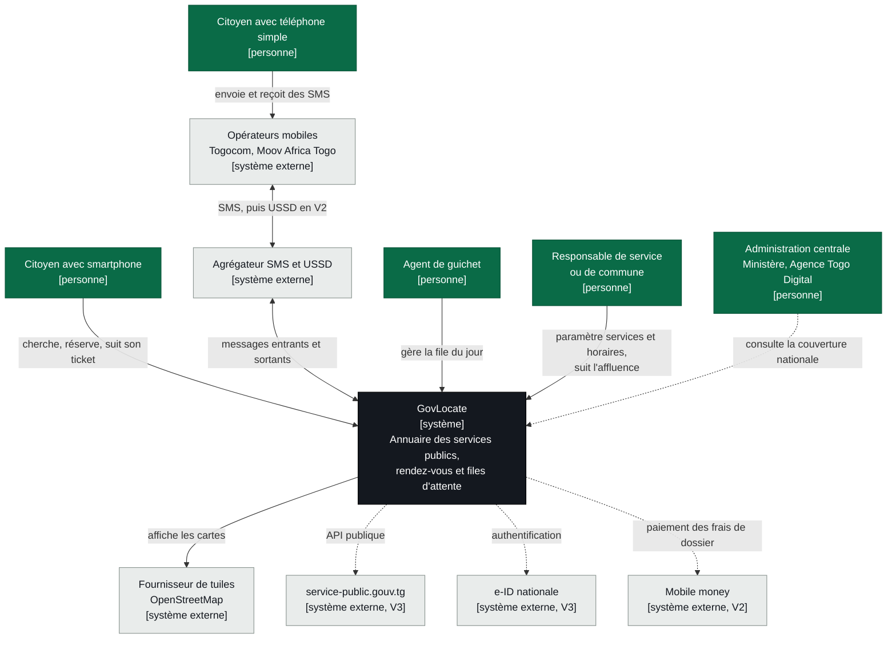

# 1. Contexte (C4 niveau 1)

Ce diagramme montre GovLocate comme une boîte unique, avec les personnes qui l'utilisent et les systèmes externes avec lesquels il échange. Les traits pointillés sont prévus pour la V2 ou la V3.

## Ce qu'il faut retenir

- **Deux portes d'entrée pour les citoyens** : l'application web (PWA) et le SMS. Le SMS n'est pas un canal secondaire. Dans la commune rurale du pilote, on vise 30 % des réservations par SMS.
- **Un seul fournisseur externe critique au MVP** : l'agrégateur SMS. Il est placé derrière une interface interne, ce qui permet d'en changer sans toucher au reste.
- **Pas de dépendance au portail national au MVP.** GovLocate se présente comme la brique guichet et rendez-vous que le portail pourra intégrer par API en V3.
