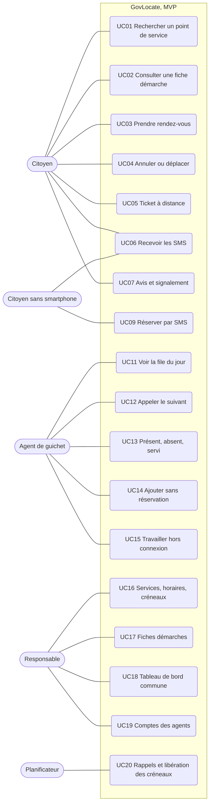

# 2. Cas d'utilisation

Chaque cas d'utilisation deviendra une ou plusieurs user stories dans le backlog. Le diagramme ne montre que le MVP. Le tableau donne aussi les versions suivantes.

## Tableau

| ID | Acteur | Cas d'utilisation | Version |
| :- | :- | :- | :- |
| UC01 | Citoyen | Rechercher un point de service par démarche ou par commune | MVP |
| UC02 | Citoyen | Consulter une fiche démarche : pièces, coût, délai, horaires | MVP |
| UC03 | Citoyen | Prendre rendez-vous | MVP |
| UC04 | Citoyen | Annuler ou déplacer un rendez-vous | MVP |
| UC05 | Citoyen | Prendre un ticket à distance et suivre sa position | MVP |
| UC06 | Citoyen | Recevoir les SMS : code, confirmation, rappel la veille, tour proche | MVP |
| UC07 | Citoyen | Donner un avis, signaler un guichet fermé ou une information fausse | MVP |
| UC08 | Citoyen | Utiliser l'application en éwé ou en kabiyè | V2 |
| UC09 | Citoyen sans smartphone | Réserver un rendez-vous par SMS | MVP |
| UC10 | Citoyen sans smartphone | Réserver et suivre son ticket par menu USSD | V2 |
| UC11 | Agent | Voir les rendez-vous et la file du jour sur un seul écran | MVP |
| UC12 | Agent | Appeler l'usager suivant | MVP |
| UC13 | Agent | Marquer un usager présent, absent ou servi | MVP |
| UC14 | Agent | Ajouter un usager venu sans réservation | MVP |
| UC15 | Agent | Continuer à travailler hors connexion, puis synchroniser | MVP |
| UC16 | Responsable | Déclarer services, horaires, créneaux et fermetures | MVP |
| UC17 | Responsable | Tenir à jour les fiches démarches | MVP |
| UC18 | Responsable | Consulter le tableau de bord de la commune | MVP |
| UC19 | Responsable | Créer et désactiver les comptes des agents | MVP |
| UC20 | Planificateur (système) | Envoyer les rappels la veille et libérer les créneaux non honorés | MVP |
| UC21 | Administration centrale | Voir la carte nationale de couverture | V2 |
| UC22 | Administration centrale | Comparer les communes et exporter les indicateurs | V2 |

## Diagramme du MVP

## Règles métier déjà connues

- **Pas de compte citoyen.** Un rendez-vous en ligne est confirmé par un code reçu par SMS. Un rendez-vous pris par SMS n'a pas besoin de code, puisque le message entrant prouve que l'usager possède le numéro.
- **Parcours de réservation en 3 écrans** après la fiche démarche : créneau, coordonnées et code, confirmation.
- **Priorité au guichet** entre rendez-vous et usagers sans réservation : à définir avec chaque commune pendant la phase 0. Proposition : un rendez-vous présent à l'heure passe avant la file.
- **Un agent ne voit que sa commune.** Un responsable ne gère que les services de sa commune.
