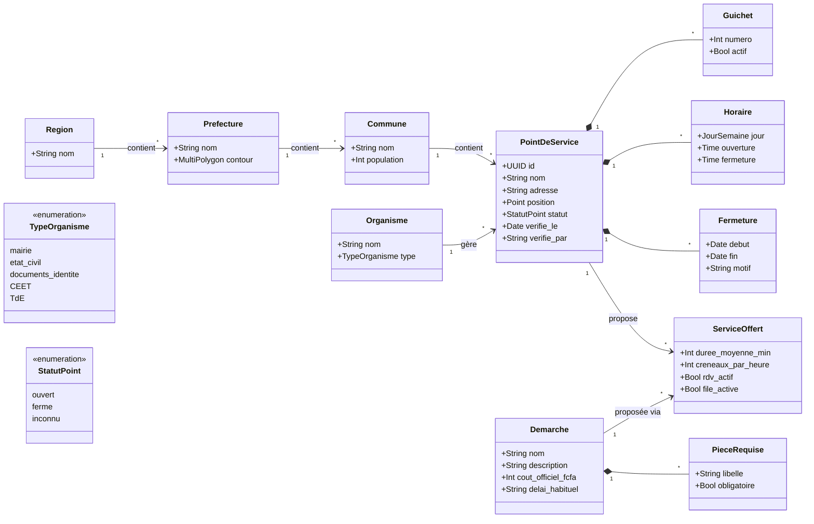
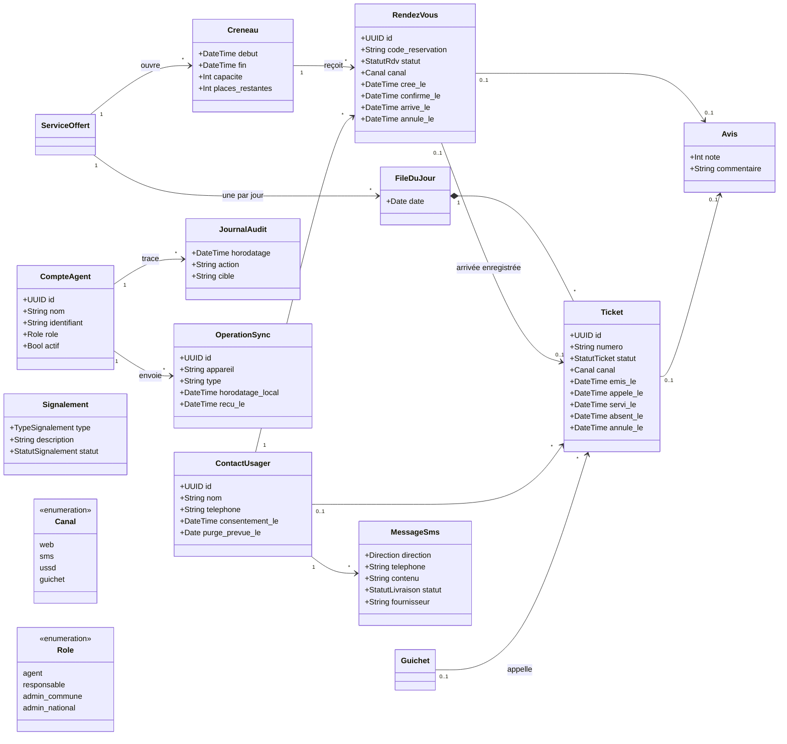

# 3. Modèle du domaine

Le modèle est découpé en deux parties pour rester lisible : l'**annuaire** (où aller, quoi apporter) et l'**accueil des usagers** (rendez-vous, files, tickets).

## 3.1 Annuaire

- **`ServiceOffert`** relie une démarche à un point de service. C'est à ce niveau qu'on règle la durée moyenne, le nombre de créneaux par heure, et l'activation des rendez-vous ou de la file.
- **`verifie_le` et `verifie_par`** s'affichent sur chaque fiche : c'est la parade du cadrage contre un annuaire périmé.
- Les 107 agences CEET et TdE du défi 2 sont importées comme `PointDeService`. Les 15 agences au statut inconnu gardent `statut = inconnu` jusqu'à leur vérification.

## 3.2 Accueil des usagers

- **`ContactUsager`** regroupe toutes les données personnelles (nom, téléphone). Les isoler dans une seule table permet de les purger à date fixe sans toucher aux statistiques.
- **Un usager sans réservation** peut ne pas laisser de numéro. Son ticket existe alors sans `ContactUsager`.
- **`OperationSync`** garde l'identifiant de chaque opération faite hors ligne. Si le même lot arrive deux fois, le serveur ne l'applique qu'une fois.
- **`MessageSms`** trace chaque SMS envoyé ou reçu. On s'en sert pour suivre le coût des SMS, la part des réservations par SMS et les échecs de livraison.
- **`Signalement`** est rattaché au `PointDeService` concerné (non représenté ici, voir 3.1).
