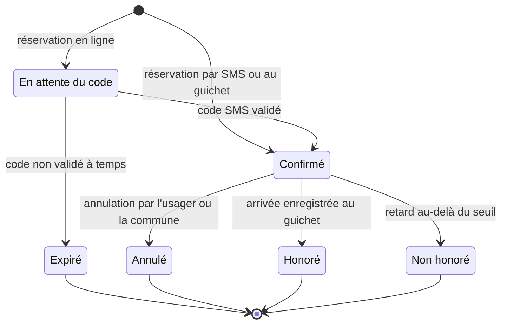
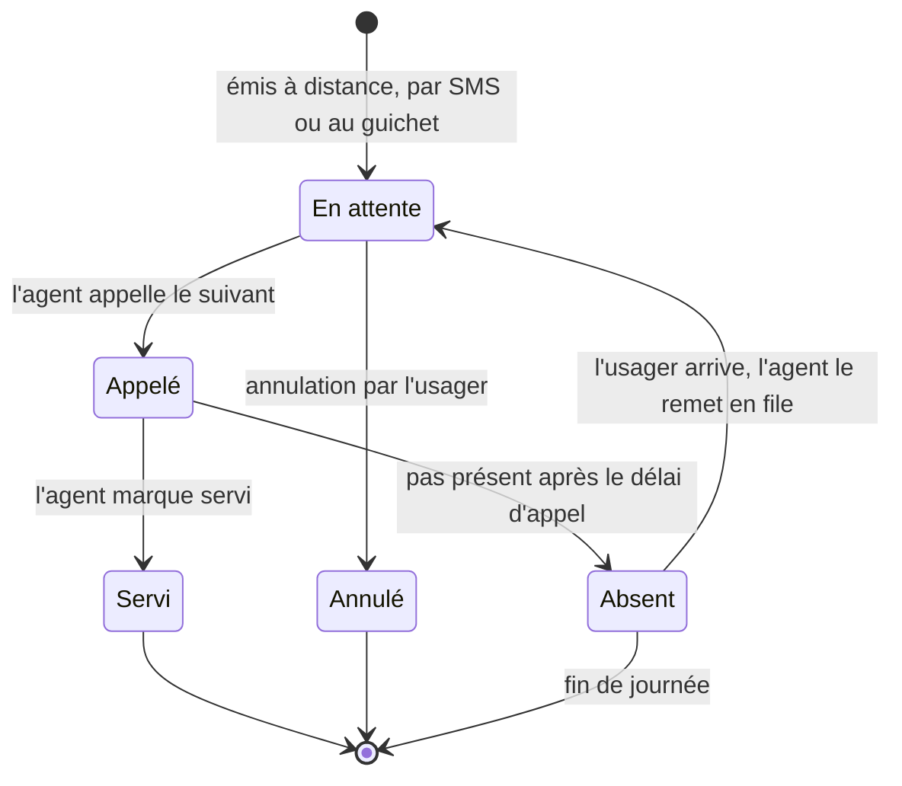

# 4. États d'un rendez-vous et d'un ticket

Chaque transition enregistre son heure dans un champ dédié (`confirme_le`, `appele_le`…). Les indicateurs du pilote se calculent à partir de ces heures, sans saisie supplémentaire.

## 4.1 Rendez-vous

- Un rendez-vous **déplacé** reste `Confirmé` : seul son créneau change, et l'ancien créneau est libéré.
- **`Expiré`** libère le créneau réservé pendant la saisie du code. Délai proposé : 10 minutes.
- **`Non honoré`** est posé par le planificateur après le seuil de retard. Seuil proposé : 15 minutes, réglable par service. Le créneau est alors libéré.
- **`Honoré`** crée un ticket dans la file du jour, prioritaire selon la règle de la commune.

## 4.2 Ticket

- Le **délai d'appel** est réglable par service. Proposition : 5 minutes.
- Un usager **absent** peut être remis en file une seule fois.
- À la fin de la journée, les tickets encore en attente passent en `Annulé`, avec le motif « fin de journée ».

## 4.3 Indicateurs calculés à partir des états

| Indicateur du pilote | Calcul |
| :- | :- |
| Temps d'attente moyen | Moyenne de `appele_le − emis_le` sur les tickets servis |
| Rendez-vous honorés | `Honoré / (Honoré + Non honoré)` |
| Usage sans smartphone | Réservations avec `canal = sms` (ou `ussd`) / toutes les réservations, par commune |
| Adoption par les agents | Guichets ayant au moins un ticket `Appelé` / guichets équipés, par jour ouvré |
| Satisfaction | Moyenne des `Avis.note` |
| Fiabilité de l'annuaire | Points de service avec `verifie_le` renseigné / points publiés |
