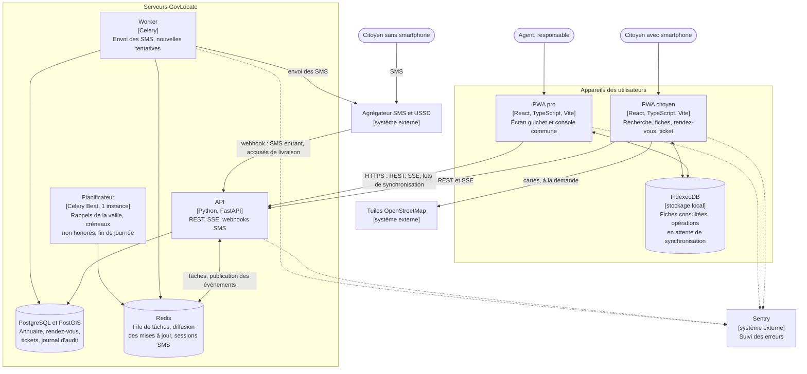

# 5. Conteneurs (C4 niveau 2)

On ouvre ici la boîte GovLocate : chaque bloc est une application ou une base de données qui se déploie séparément.

## Rôle de chaque conteneur

| Conteneur | Responsabilité | Ce qu'il ne fait pas |
| :- | :- | :- |
| PWA citoyen | Recherche, fiches démarches, réservation, suivi du ticket. Garde les dernières fiches consultées pour s'ouvrir sans réseau. | Aucun écran réservé aux agents. Aucun accès sans passer par l'API. |
| PWA pro | Écran guichet (file du jour, appel du suivant) et console commune (services, horaires, fiches, tableau de bord). Enregistre les actions hors ligne et les synchronise au retour du réseau. | Pas accessible sans compte nominatif. |
| API | Seul point d'accès aux données. Applique les règles métier, les droits par commune et le journal d'audit. Diffuse les changements de file en SSE. Reçoit les webhooks de l'agrégateur SMS. | N'envoie jamais un SMS elle-même, elle confie l'envoi au worker pour répondre vite. |
| Worker | Envoie les SMS et réessaie en cas d'échec. Exécute les tâches longues. | Ne reçoit aucune requête de l'extérieur. |
| Planificateur | Déclenche les tâches à heure fixe : rappels de la veille, passage en « non honoré », clôture des files le soir, purge des données personnelles arrivées à échéance. | Une seule instance, pour ne jamais envoyer deux fois le même rappel. |
| PostgreSQL et PostGIS | Source de vérité. Recherche des points de service les plus proches grâce à l'index spatial. | — |
| Redis | File de tâches de Celery. Diffusion des événements « file mise à jour » entre les instances de l'API. État des conversations SMS en cours (avec expiration). | Aucune donnée qu'on ne pourrait pas perdre. |

## Choix structurants

- **SSE plutôt que WebSocket.** Seul le serveur pousse des mises à jour. Le navigateur se reconnecte tout seul, et les actions passent par des appels REST classiques.
- **Une seule API pour tous les canaux.** Le web, le SMS et le guichet appliquent exactement les mêmes règles.
- **Un client d'API généré** à partir du contrat OpenAPI de FastAPI pour les deux PWA. Le front et le back ne peuvent pas diverger sans que la compilation échoue.
