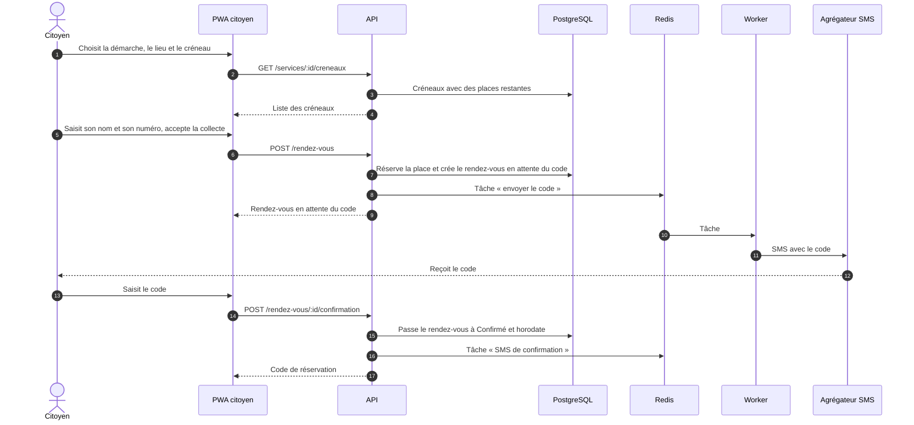
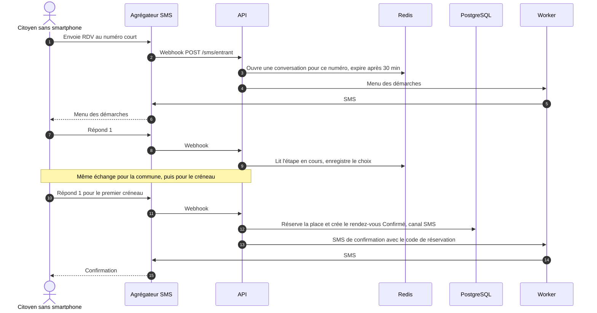
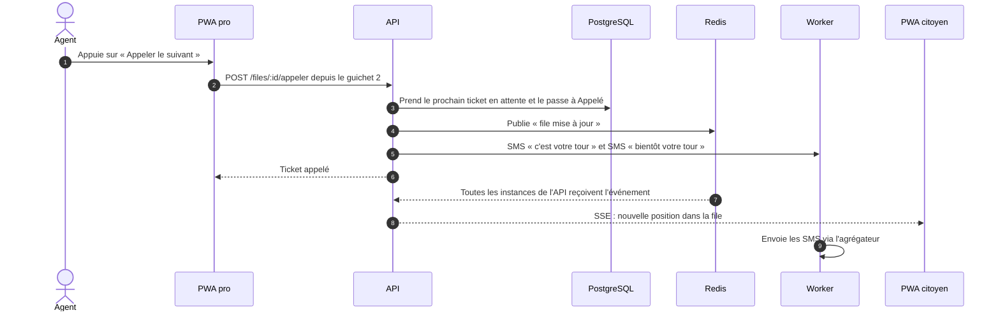
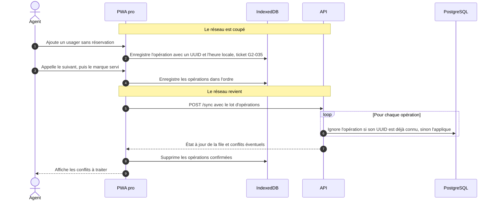

# 6. Séquences des flux critiques

Quatre flux concentrent les risques techniques du MVP. Les autres (recherche, fiches, console) sont de simples lectures et écritures.

## 6.1 Réserver en ligne

- La place est réservée **dès l'étape 7**, pour qu'un autre usager ne la prenne pas pendant la saisie du code. Si le code n'est pas validé à temps, le rendez-vous passe en `Expiré` et la place est libérée.
- L'envoi du code est **plafonné** par numéro et par adresse IP, et limité aux numéros en +228, contre la fraude au « SMS pumping ».

## 6.2 Réserver par SMS

- **Pas de code de vérification** : le SMS entrant prouve déjà que l'usager possède le numéro.
- L'API **vérifie la signature** de chaque webhook et ignore un message déjà reçu, car l'agrégateur peut renvoyer le même message plusieurs fois.
- Les textes exacts sont dans [sms-ussd.md](../design/sms-ussd.md).

## 6.3 Appeler l'usager suivant

- Le prochain ticket est pris avec un verrou qui **saute les lignes déjà verrouillées** (`FOR UPDATE SKIP LOCKED`). Deux guichets qui appellent au même instant n'obtiennent jamais le même usager.
- Le SMS « bientôt votre tour » part quand il reste **2 personnes** avant l'usager. Ce seuil est réglable par service.

## 6.4 Synchroniser après une coupure

### Règles de résolution des conflits (à valider en phase 1)

| Situation | Règle |
| :- | :- |
| Un ticket à distance a été annulé par l'usager, mais le guichet hors ligne l'a servi | **Le guichet gagne** : l'usager était physiquement présent. |
| Deux guichets hors ligne ont appelé le même ticket à distance | Le premier lot reçu par le serveur gagne. L'autre agent voit un conflit et rappelle quelqu'un d'autre. |
| Le guichet a créé des tickets hors ligne | Pas de conflit possible : la série `G2-` n'appartient qu'au guichet n° 2. |
| La session de l'agent a expiré pendant la coupure | Les opérations restent dans IndexedDB. L'agent se reconnecte, puis la synchronisation reprend. |
