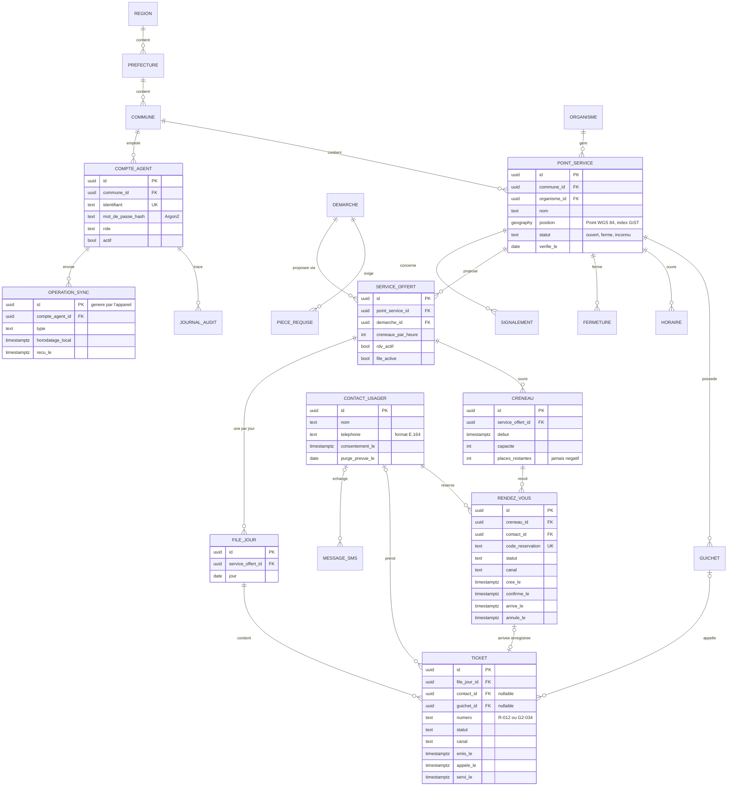

# 7. Modèle de données (PostgreSQL)

Version 0, issue du [modèle du domaine](03-modele-domaine.md). Seules les colonnes structurantes sont montrées. Le schéma définitif sera écrit sous forme de migrations Alembic au sprint 1.

## Contraintes et index importants

| Élément | Pourquoi |
| :- | :- |
| Index GiST sur `point_service.position` | Recherche des points les plus proches (`ST_DWithin`, tri par distance) |
| `UNIQUE (file_jour_id, numero)` | Un numéro de ticket n'existe qu'une fois par file et par jour |
| `UNIQUE (service_offert_id, jour)` sur `file_jour` | Une seule file par service et par jour |
| `UNIQUE code_reservation` | Le code présenté au guichet désigne un seul rendez-vous |
| `CHECK (places_restantes >= 0)` sur `creneau` | Impossible de surréserver, même avec des requêtes simultanées |
| Index partiel sur `ticket (file_jour_id, emis_le) WHERE statut = 'en_attente'` | « Appeler le suivant » reste instantané, même avec beaucoup de tickets |
| Clé primaire `operation_sync.id` fournie par l'appareil | Un lot de synchronisation reçu deux fois n'est appliqué qu'une fois |

## Données personnelles

- Le nom et le téléphone ne sont stockés que dans `contact_usager`.
- Le planificateur efface ou anonymise les contacts arrivés à `purge_prevue_le`. Les rendez-vous et tickets restent pour les statistiques, sans lien vers une personne.
- La durée de conservation reste à fixer avec le juriste en phase 0.
