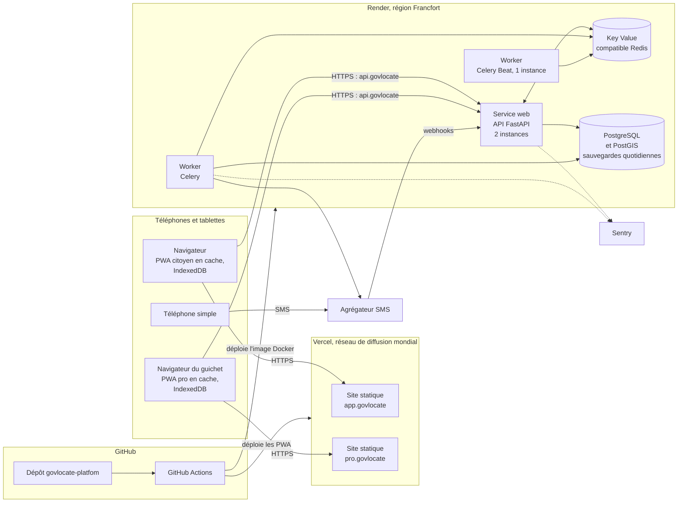

# 8. Déploiement du MVP

Hébergement retenu pour le MVP et le pilote : **Vercel pour les deux PWA, Render (région Francfort) pour le backend**. Les raisons sont dans l'[ADR 0001](../adr/0001-hebergement-mvp.md).

Les noms de domaine (`app.`, `pro.`, `api.`) sont des exemples : le domaine reste à choisir.

## Environnements

| Environnement | Front | Back | Déclenchement |
| :- | :- | :- | :- |
| Local | Vite en mode développement | Docker Compose : API, worker, PostgreSQL et PostGIS, Redis, adaptateur SMS factice | Sur le poste de chaque développeur |
| Aperçu | Un déploiement Vercel par pull request, avec son propre lien | API de préproduction | Automatique à chaque pull request |
| Préproduction | Vercel, branche `master` | Render, services de préproduction, données fictives | Automatique à chaque fusion sur `master` |
| Production | Vercel | Render, services de production | Tag de version et validation manuelle |

Les liens d'aperçu Vercel servent aux revues de maquettes et aux démonstrations aux communes. Chacun peut ouvrir une version sur son téléphone avant la fusion.

## Règles d'exploitation

- **Le front reste un site statique.** On n'utilise ni les fonctions serverless ni le middleware de Vercel : les PWA peuvent partir vers n'importe quel CDN sans réécriture.
- **Le back tourne en images Docker.** La même image sert en local, en préproduction et en production. Elle peut être déplacée vers un hébergeur au Togo si l'avis juridique l'exige (voir le plan B de l'ADR 0001).
- **Infrastructure décrite en code.** Les fournisseurs Terraform de Vercel et de Render décrivent les services, les variables et les domaines.
- **Sauvegardes.** En plus des sauvegardes de Render, un export quotidien part vers un stockage externe. Une restauration est testée chaque mois.
- **Supervision.** Sentry pour les erreurs, les métriques et journaux de Render, et une sonde de disponibilité externe sur `api.` et sur les deux sites.
