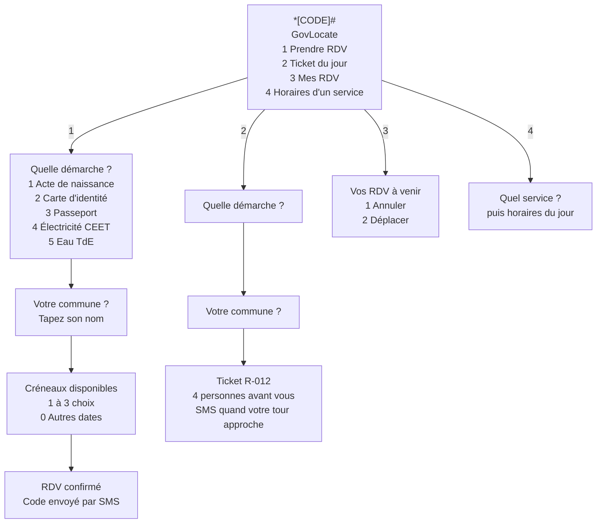

# Textes SMS et menu USSD

Ces canaux servent les usagers sans smartphone. On ne les maquette pas dans un outil graphique : on écrit les textes exacts et l'enchaînement des messages.

## Contraintes

- **SMS : 160 caractères au plus, en alphabet GSM-7.** Les lettres é, è, à, ù et É font partie de cet alphabet. En revanche, ê, â, î, ô, û, ç, ï, ë, l'apostrophe courbe ’ et les guillemets « » n'en font pas partie : un seul de ces caractères limite le message à 70 caractères et fait payer 2 ou 3 SMS au lieu d'un.
- **USSD : 182 caractères au plus par écran.** La durée d'une session est limitée et sera confirmée avec l'opérateur.
- **Mots courts et connus.** On écrit « RDV », pas « rendez-vous administratif ». On répond par un chiffre.

Tous les textes ci-dessous ont été vérifiés : alphabet GSM-7 et longueur.

## Conversation de réservation par SMS (MVP)

L'usager écrit au numéro court [NUMÉRO COURT]. Chaque étape attend une réponse. La conversation est oubliée après 30 minutes sans réponse.

| Étape | Message | Caractères |
| :- | :- | -: |
| L'usager envoie | `RDV` | — |
| Menu des démarches | `GovLocate : quelle démarche ?` `1 Acte de naissance` `2 Carte d'identité` `3 Passeport` `4 Électricité CEET` `5 Eau TdE` `Répondez par le numéro.` | 133 |
| L'usager répond | `1` | — |
| Choix de la commune | `Dans quelle commune ? Exemple : Agoè-Nyivé 1` | 44 |
| L'usager répond | `Agoè-Nyivé 1` | — |
| Choix du créneau | `Mairie d'Agoè-Nyivé 1, prochains créneaux :` `1 Mar 3/11 8h30` `2 Mar 3/11 10h00` `3 Mer 4/11 8h00` `Répondez par le numéro.` | 116 |
| L'usager répond | `1` | — |
| Confirmation | `RDV confirmé : mardi 3/11 à 8h30, Mairie d'Agoè-Nyivé 1. Code GL-7K4P. Apportez votre pièce d'identité. Pour annuler, envoyez ANNULER.` | 134 |

Si la commune tapée est ambiguë, par exemple « Agoè » seul, le serveur renvoie une liste numérotée des communes possibles.

## Autres messages

| Usage | Message | Caractères |
| :- | :- | -: |
| Code de vérification (réservation en ligne) | `GovLocate : votre code est 4821. Il expire dans 10 minutes. Ne le partagez avec personne.` | 89 |
| Rappel la veille | `Rappel GovLocate : demain 8h30, Mairie d'Agoè-Nyivé 1. Code GL-7K4P. Apportez votre pièce d'identité.` | 101 |
| Bientôt votre tour | `GovLocate : plus que 2 personnes avant vous (ticket R-012). Présentez-vous au guichet 2 de la Mairie d'Agoè-Nyivé 1.` | 116 |
| C'est votre tour | `C'est votre tour ! Ticket R-012 : guichet 2, Mairie d'Agoè-Nyivé 1.` | 67 |
| Annulation | `Votre RDV du mardi 3/11 à 8h30 est annulé. Pour reprendre RDV, envoyez RDV.` | 75 |
| Message non compris | `Nous n'avons pas compris. Envoyez RDV pour prendre rendez-vous ou TICKET pour la file du jour.` | 94 |

Mots-clés reconnus, en majuscules ou en minuscules : `RDV`, `TICKET`, `ANNULER`, `AIDE`.

## Menu USSD (V2)

Chaque écran USSD doit tenir en 182 caractères. Le code de réservation est toujours renvoyé par SMS, pour que l'usager le garde une fois la session fermée.
